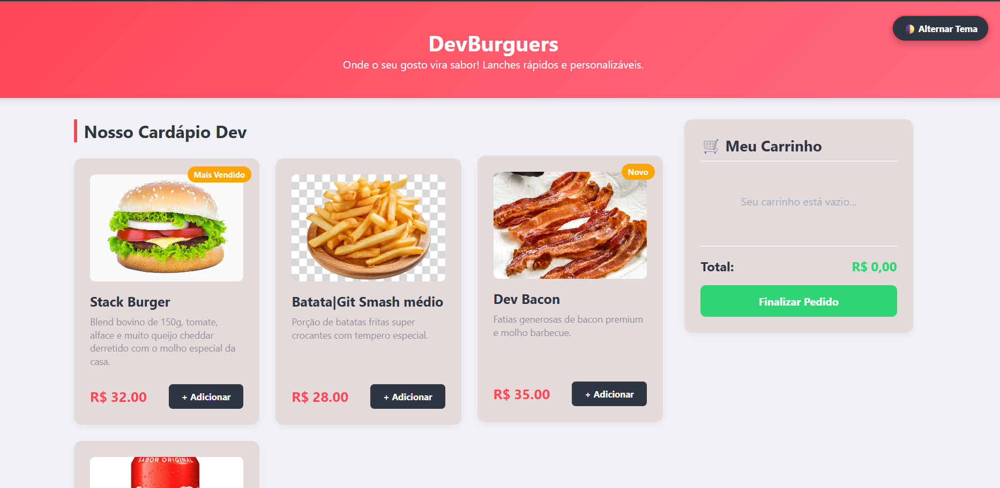
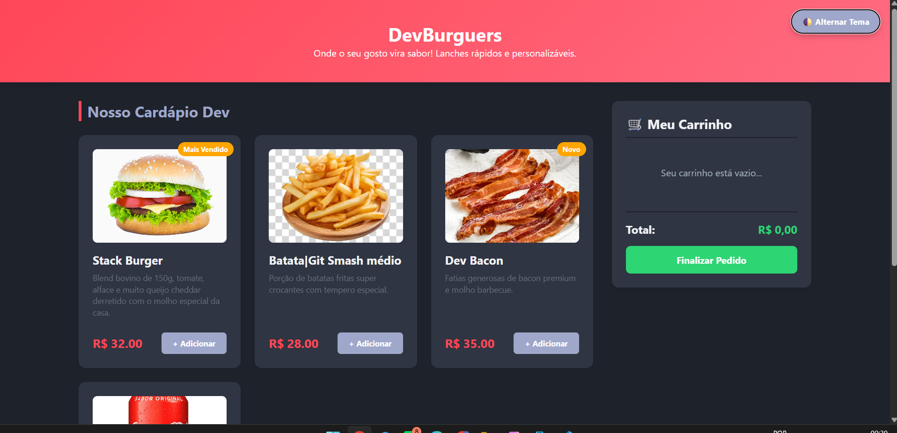
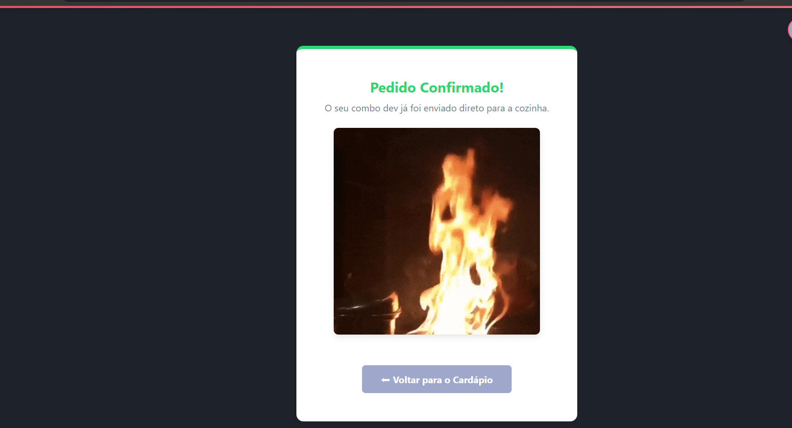

### DevBurguer — Cardápio Digital & Simulador de Compras

Projeto  de desenvolvido como critério avaliativo para o **Desafio 1** da trilha de **Desenvolvimento Mobile** da plataforma **Mais Robotic (3ª Edição)**. 

O sistema consiste em uma aplicação web interativa para uma hamburgueria, simulando a experiência real de um e-commerce. O usuário interage com a vitrine de produtos adicionando e removendo itens de um carrinho lateral que atualiza quantidades, valores parciais e o montante global de forma dinâmica, contando ainda com navegação entre páginas e controle de acessibilidade visual. 

### 👤 Informações do Aluno

* **Nome do Aluno:** S Henrique Jr(como arquivo é publico não irei colocar todo meu nome)
* **Trilha:** Desenvolvimento Mobile
* **Contexto:** Desafio 1 — Simulador de Compras
* **Data de Entrega:** 30/10/2026

### Apresentação da Loja & Cardápio

A **DevBurguer** é uma lanchonete temática voltada para a comunidade de tecnologia. Seu cardápio conta com blends artesanais premium e bebidas refrigerantes estruturados na tabela de dados da aplicação: 

* **Stack Burger (R$ 32,00):** Blend bovino de 150g, tomate, alface e muito queijo cheddar derretido com o molho especial da casa. [Badge: Mais Vendido]
* **Batata | Git Smash médio (R$ 28,00):** Porção de batatas fritas super crocantes com tempero especial.
* **Dev Bacon (R$ 35,00):** Hambúrguer artesanal com fatias generosas de bacon premium e molho barbecue. [Badge: Novo]
* **Refri Co-Pilot (R$ 6,00):** Lata de refrigerante trincando de gelada para acompanhar seu combo.

###  Tecnologias Utilizadas

* **HTML:** Estruturação semântica de layouts (<header>, <main>, <aside>, <section>).
* **CSS:** Estilização responsiva baseada em CSS Grid Layout, Flexbox estrutural, transições de opacidade e gerenciamento de paleta de cores via variáveis personalizadas (--variables).
* **JavaScript:** Lógica funcional de estado, escuta de eventos, arrays de objetos e renderização dinâmica baseada em manipulação ativa do DOM (*Document Object Model*).
* **Git & GitHub:** Versionamento local, controle de histórico e hospedagem remota de arquivos.

###  Instruções de Execução

1. Clone esse Repositório para sua máquina.(opcional para teste interno)
2. Certifique-se de que o repositório contém a pasta local de imagens assets/ populada corretamente.
3. Abra o arquivo raiz index.html in qualquer navegador web moderno (Google Chrome, Microsoft Edge, Mozilla Firefox ou Safari).
4. Para simular compras locais, utilize os botões **"+ Adicionar"** nos cards dos produtos e veja o carrinho preencher a barra lateral automaticamente.
5. Para alternar a paleta visual, clique no botão flutuante **"🌓 Alternar Tema"** no canto superior direito.

###  Captura de Tela da Página

1. Página Inicial tema claro

2. Página inicial tema escuro

3. Página de confirmação de pedido

###  Testes Realizados

Os testes de comportamento foram feitos diretamente via console de desenvolvedor e interface do usuário, validando os seguintes cenários cruciais: 

1. **Teste de Estado Vazio:** Validação do bloqueio do botão "Finalizar Pedido" caso nenhum item esteja contido no array do carrinho, disparando um alerta nativo de bloqueio.
2. **Teste de Persistência:** Alternância para o Modo Escuro no botão flutuante seguido de recarregamento forçado da página (F5), garantindo que o layout permanecesse retido na cor escura através da verificação de chave-valor.
3. **Teste de Soma Monetária:** Inclusão de múltiplos itens de preços variados para conferência de ponto flutuante via método .toFixed(2), garantindo que centavos e somatórios finais batessem exatamente com os valores reais.
4. **Teste de Subtração de Itens:** Clique no botão "Remover" para conferir se as quantidades decrementavam unitariamente e se o elemento sumia por completo do HTML ao bater o valor zero.

###  Dificuldade Encontrada & Aprendizado

A maior dificuldade inicial do projeto ocorreu durante a **refatoração e manipulação do DOM**. No início do desafio, a aplicação rodava dependente exclusivamente de caixas de entrada sequenciais (prompt() e alert()). Migrar essa lógica para um comportamento em tempo real onde cliques em botões HTML criam ou destroem nós visuais exigiu um estudo focado no uso de seletores e no entendimento de escopos de funções. 

Através desse desafio, compreendi como gerenciar um array de objetos em memória interna no JavaScript (estado) e fazer com que a tela reaja puramente baseada nos dados contidos ali dentro, limpando e injetando elementos filhos dinamicamente com o appendChild(). 

###  Uso de Inteligência Artificial

Para a concepção e evolução deste projeto, utilizei uma Inteligência Artificial como assistente técnico e copiloto de código, mantendo total transparência com os critérios do edital. 

* **Como ajudou:** A IA me auxiliou diretamente na transformação completa da lógica do simulador, mostrando como abandonar os antigos recursos de pop-up (alert e prompt) para construir uma interface reativa baseada em manipulação de elementos do DOM. Ela também forneceu a estrutura do código CSS usando Grid Layout e Flexbox para organizar a loja em colunas e implementou o gerenciamento de variáveis de cores (:root) para o alternador de temas. Por fim, a IA me ajudou a refatorar o esqueleto original deste arquivo README.md para deixá-lo explicado passo a passo, cobrindo com rigor todas as exigências de documentação do desafio.
* **O que você adaptou:** Eu gerenciei a estrutura física do projeto localmente na minha máquina pelo VS Code e adaptei o banco de dados interno de produtos no arquivo JavaScript para exibir as fotos que eu mesmo escolhi e salvei na minha pasta local assets. Removi itens antigos como porções de batatas convencionais para inserir o produto "Batata | Git Smash médio" e ajustei caminhos lógicos para que as funções de alternar tema fossem reaproveitadas e rodassem de forma segura na página secundária de confirmação do pedido.
* **Como verificou o resultado:** Monitorei todas as alterações usando o terminal integrado do Git para entender quais arquivos e linhas estavam sendo azulados ou modificados. Abri a aplicação diretamente no navegador para testar os callbacks de clique nos botões, usei a ferramenta de inspeção do desenvolvedor (F12) para validar que os dados do LocalStorage persistiam após o reload da página e certifiquei-me de que compreendo toda a árvore lógica do código antes de realizar o envio oficial do repositório no GitHub.